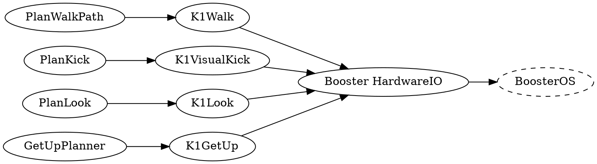

BoosterOS, the Booster K1's firmware, currently handles all locomotion and get-up routines on the Booster K1, and exposes them through the [Booster Robotics SDK](https://github.com/BoosterRobotics/booster_robotics_sdk).

## Motion modes

The K1 is always in one of five motion modes. The mode determines which SDK commands the robot accepts.

| Mode     | Description                                                                |
| -------- | -------------------------------------------------------------------------- |
| `DAMP`   | Dampens the robot's joints (used commonly as the K1's e-stop).             |
| `PREP`   | The robot holds a fixed standing pose.                                     |
| `WALK`   | The robot can be walked around; typically used alongside the controller.   |
| `CUSTOM` | Direct joint control (not currently used)                                  |
| `SOCCER` | The robot goes into a faster gait, and can perform soccer-specific skills. |

A mode change is requested by emitting a [`BoosterMode`](https://github.com/NUbots/NUbots/blob/main/shared/message/booster/BoosterMode.proto) message. The [Booster HardwareIO module](https://github.com/NUbots/NUbots/tree/main/module/platform/Booster/HardwareIO) turns these into SDK calls and publishes the robot's current mode as `BoosterModeState`.

Switching to `PREP` takes a moment. Changing into prep mid-stride makes the robot fall, so HardwareIO first commands a zero velocity, waits `prep_settle_time` seconds for the gait to stop, then switches. Another mode request during that window cancels the pending switch.

While the robot is in prep, or waiting to enter it, HardwareIO discards any movement commands.

Any mode transition invalidates the odometry track, so HardwareIO resets the SDK odometry on every mode change.

## Walking

The [K1Walk module](https://github.com/NUbots/NUbots/tree/main/module/skill/K1Walk) provides the [Walk Task](https://github.com/NUbots/NUbots/blob/main/shared/message/skill/Walk.proto) in the [Director system](/system/foundations/director). It requests `SOCCER` mode when the Task starts, then forwards the commanded velocity to the SDK as a `BoosterWalk` message.

The walk command gives a vector `[x, y, z]`:

| Variable | Description                                                                                |
| -------- | ------------------------------------------------------------------------------------------ |
| `x`      | velocity in metres per second in the direction of the x axis                               |
| `y`      | velocity in metres per second in the direction of the y axis                               |
| `z`      | yaw in radians per second, positive is counter-clockwise. The 0 point is straight forward. |

The robot's [behaviour](/system/subsystems/behaviour) determines the walk vector, usually via [PlanWalkPath](https://github.com/NUbots/NUbots/tree/main/module/planning/PlanWalkPath).

### In-walk kick

When the `kick` field on the Walk Task is set, K1Walk drives a fixed forward velocity burst for a fixed duration.

| Config value    | Description                                                                 |
| --------------- | --------------------------------------------------------------------------- |
| `kick.velocity` | The velocity `[x, y, theta]` held during the burst, in m/s and rad/s.       |
| `kick.duration` | How long to hold that velocity before the kick reports as done, in seconds. |

## Kicking

The [K1VisualKick module](https://github.com/NUbots/NUbots/tree/main/module/skill/K1VisualKick) provides the [Kick Task](https://github.com/NUbots/NUbots/blob/main/shared/message/skill/Kick.proto) using the SDK's visual kick. [PlanKick](https://github.com/NUbots/NUbots/tree/main/module/planning/PlanKick) decides when to kick, checking that the ball measurement is recent, the ball is close enough and roughly in front, and the robot is aligned to the target.

Starting the kick requires that the robot be in `SOCCER` mode, and that it is in visual kick mode, which puts the robot into the mode that listens for visual kick messages through the SDK.

The reference comes from our own localisation, converted out of world space into the robot-relative terms the SDK takes:

| Field                  | Description                                                                                                   |
| ---------------------- | ------------------------------------------------------------------------------------------------------------- |
| `x`, `y`               | The kick reference point, a fraction of the way from the robot to the ball, set by `ball_reference_fraction`. |
| `dir`                  | The kick direction, as the angle of the Kick Task's direction vector.                                         |
| `power`                | The magnitude of the direction vector, scaled by `power_scale`.                                               |
| `goal_x`, `goal_y`     | The kick target in robot space.                                                                               |
| `robot_theta_to_field` | The robot's heading relative to the field.                                                                    |

The kick ends if the ball moves more than `min_ball_move_distance` from where it started, or after `kick_duration` seconds have elapsed. Stopping the Task stops the visual kick mode.

## Getting up

BoosterOS detects falls itself and publishes a fall state, which HardwareIO republishes as [`BoosterFallDownState`](https://github.com/NUbots/NUbots/blob/main/shared/message/booster/BoosterFallDownState.proto) with one of `IS_READY`, `IS_FALLING`, `HAS_FALLEN` or `IS_GETTING_UP`.

[GetUpPlanner](https://github.com/NUbots/NUbots/tree/main/module/planning/GetUpPlanner) emits a GetUp Task when the angle between the torso's z axis and the world z axis exceeds `fallen_angle`. The [K1GetUp module](https://github.com/NUbots/NUbots/tree/main/module/skill/K1GetUp) provides that Task: if the robot has fallen and the SDK reports recovery is available, it triggers the SDK's get-up routine. It reports `Done` once the fall state returns to `IS_READY`, at which point it marks the robot as standing and resets field localisation, because the get-up invalidates odometry.

## Head motion

The [K1Look module](https://github.com/NUbots/NUbots/tree/main/module/skill/K1Look) provides the Look Task. It takes a unit vector in torso space, converts it into head yaw and pitch, and emits a `BoosterHeadRot` for HardwareIO to send to the SDK.

HardwareIO clamps the result to the K1's limits before sending it:

| Axis    | Range (radians)   | Sign              |
| ------- | ----------------- | ----------------- |
| `yaw`   | `[-0.785, 0.785]` | leftward positive |
| `pitch` | `[-0.3, 1.0]`     | downward positive |
